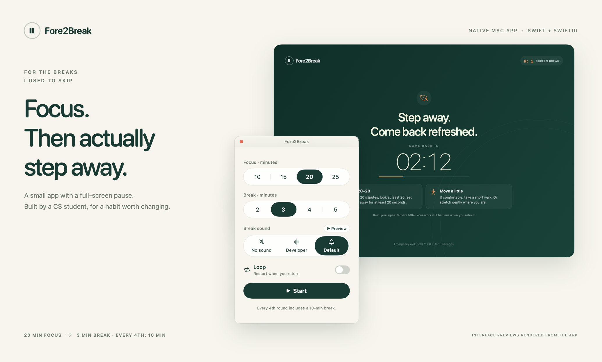
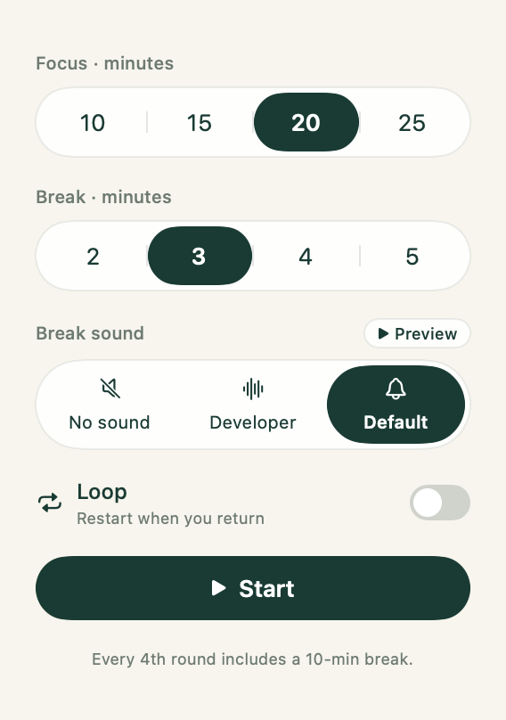
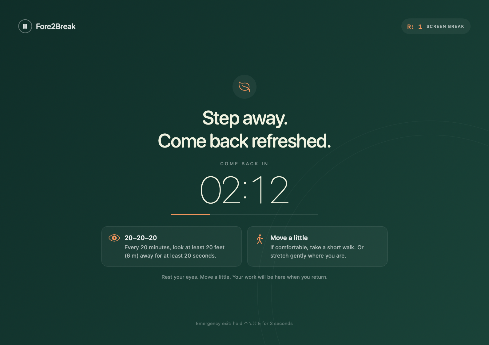
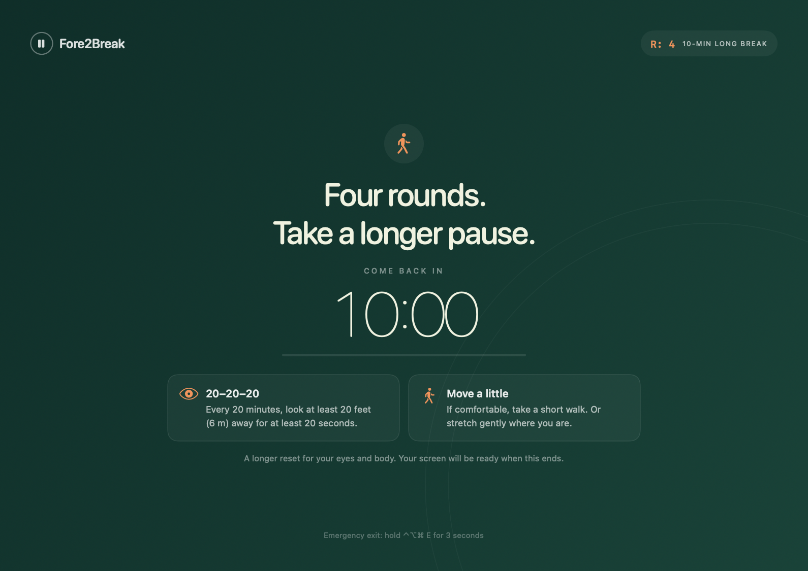

# Fore2Break

A small native Mac app that helps you step away from your screen.

As a computer science student, I spend most of my day looking at a screen. I kept telling myself I would rest my eyes for a minute or two after every 20–25 minutes. I set timers, heard them ring, and kept working instead.

So I decided to vibe code **Fore2Break** with AI assistance. It’s a small native Mac app that stays out of the way while I work, then covers my displays with a break countdown. I built it for the reminders I kept ignoring.



[How it works](#how-it-works) · [Screenshots](#a-closer-look) · [Build and run](#build-and-run) · [Audio credits](#audio-acknowledgment)

## How it works

1. Open the app and choose your focus and break times in the compact popup.
2. Press **Start**. The popup disappears while you work.
3. When focus time ends, a countdown covers every connected display, across Spaces. Normal app switching is blocked during the break. The screen encourages you to look away and walk a little.
4. At the natural end of the break, the desktop returns, the completion sound plays once, and the completed-round count increases.
5. With Loop off, click the floating circle to start another session. You can drag the circle to a convenient spot. With Loop on, no circle appears; the app waits for your first activity to start the next session.

| Setting | Default | Choices |
| --- | --- | --- |
| Focus | 20 minutes | 10, 15, 20, 25 minutes |
| Standard break | 3 minutes | 2, 3, 4, 5 minutes |
| Loop | Off | On or off |

Your durations and Loop preference are saved. The menu bar shows the round indicator, remaining time, and settings. **The app must stay open** for its timers and break screens to work.

### A longer pause every four rounds

A round is a focus session followed by its naturally completed break. The first three rounds use your selected standard break. The fourth uses a **10-minute break** in its place, then the pattern repeats: short, short, short, long on rounds **4, 8, 12, …**. Your saved standard break choice stays unchanged.

Round progress appears as **`R:n`** in the menu bar and on the break screen. During focus or a break, it shows the current round; when idle, it shows the completed count, starting at `R:0`. For example, the menu can show `R:4 | 12:34` during the fourth focus session. Round counts start fresh each time you launch the app; they are not saved between launches. Ending a break with the emergency shortcut does not count as completing a round.

### Reminders to look away and move

The break screen includes a **20-20-20** reminder: every 20 minutes, look at something **at least 20 feet (about 6 metres) away for at least 20 seconds**. It also encourages you to take a short walk or stretch where you are. These are prompts within the break; your chosen focus interval still controls when it begins. The eye-rest reminder follows the [American Academy of Ophthalmology's guidance on eye strain](https://www.aao.org/eye-health/diseases/what-is-eye-strain).

### Optional Loop mode

With **Loop on**, the first mouse movement, click, scroll, or keypress after a completed break starts the next focus session using your saved durations. If you stay away from the computer, the app waits. **The floating circle stays hidden in Loop mode.** Activity during the break does not start a new timer or shorten the break.

The first session always needs a manual **Start**. With **Loop off**, each later session also waits for Start or a click on the circle. Opening settings cancels a pending automatic restart, so changing a setting does not unexpectedly start a timer.

### Emergency exit

During a break, hold **Control + Option + Command + E** for **3 seconds** to return to the desktop. This leaves the app idle, plays no completion sound, does not complete a round, and does not restart Loop. Start again from the menu bar when ready, or click the circle with Loop off.

Fore2Break is a break reminder, not a security lock. macOS recovery controls, including Force Quit, remain available.

## A closer look

**Choose your times and press Start.**



**Take a break while the countdown runs.**



**Every fourth round gives you a 10-minute break.**



**Keep round progress and the timer in view.**


**With Loop off, click to begin again or drag the circle out of the way.**


## Build and run

Requires **macOS 13 or later** and Apple’s Command Line Tools. The build supports Apple silicon and Intel Macs; it produces a universal app when both compiler targets are available and reports an Apple silicon build otherwise.

The repository includes the source and screenshots. Third-party audio and prebuilt binaries are excluded until the audio’s redistribution rights are confirmed.

1. Install Apple’s Command Line Tools if needed:

   ```sh
   xcode-select --install
   ```

2. The build requires **`Resources/BreakComplete.mp3`**. Your local working folder includes the selected sound there, ignored by Git. For a fresh clone or a public release, supply audio you have permission to use and distribute.
3. From the project folder, run:

   ```sh
   ./test.sh
   ./build.sh
   ```

The build creates **`dist/Fore2Break.app`** and **`dist/Fore2Break.zip`**. Open the app to begin. No Xcode project or third-party packages are needed. Build files stay in `.build/`.

The included `.gitignore` keeps generated apps and archives, build caches, macOS metadata, editor files, local environment settings, and the private audio clip out of source control.

After building, you can run the app integration checks:

```sh
RUN_UI_TESTS=1 ./test.sh
```

These checks briefly show the actual break screens, so run them when you can pause other work. The standalone tests cover timer transitions and the activity gate; the app checks cover window behavior, Loop, emergency release, and completion-sound wiring.

To install a local build, move `dist/Fore2Break.app` into **Applications**. Builds are locally signed and are not notarized by Apple. If macOS blocks opening the app, follow [Apple’s opening instructions](https://support.apple.com/en-us/102445).

## Built with

Swift, SwiftUI, AppKit, and AVFoundation. The timer uses a continuous clock so changing the Mac’s wall clock does not shorten a session.

No account or network connection is required. Loop checks aggregate system interaction counts; it does not read or store what you type, click, or scroll.

```text
Source/               Native app, views, timer, activity gate, audio playback
Tests/                Deterministic timer and activity-gate tests
Tools/                App icon generator
Resources/Info.plist  App metadata
build.sh              Build and package the Mac app
test.sh               Run tests
index.html            Standalone project page
assets/               Screenshots and project visuals
content.txt           LinkedIn post draft
```

### Audio acknowledgment

**Break-completion sound:** [“Developers developers developers” on Voicy](https://www.voicy.network/sounds/EeANbw06ckmVBdggH_6kjA-developers-developers-developers), uploaded by **crazygipi**. The development build uses the file `Voicy_Developers developers developers.mp3`, bundled as `BreakComplete.mp3`. The clip was not created for this project.

Credit acknowledges the source; it does **not** grant permission to redistribute the recording. The original recording’s ownership and this clip’s redistribution rights have not been verified. See [Voicy’s terms](https://www.voicy.network/terms-and-conditions).

The original MP3 is kept locally at `Resources/BreakComplete.mp3` and ignored by Git; it should stay out of the public repository. Before publishing a build, confirm permission for the audio or use a sound you are licensed to distribute. Generated apps and archives are also ignored by Git.

## Project page

Download and open [index.html](index.html) in a browser to view the project page. Its styles, script, and images are embedded, so the page also works offline as one file. GitHub displays HTML as source until it is downloaded or hosted.

If you want to host that page with GitHub Pages after pushing this folder’s contents to your repository:

1. Open the repository’s **Settings → Pages**.
2. Under **Build and deployment**, choose **Deploy from a branch**.
3. Select the branch containing `index.html`, choose **/(root)**, and click **Save**.

GitHub will provide the site address after publication. See [GitHub’s Pages setup documentation](https://docs.github.com/en/pages/getting-started-with-github-pages/configuring-a-publishing-source-for-your-github-pages-site).
# Force2Break
